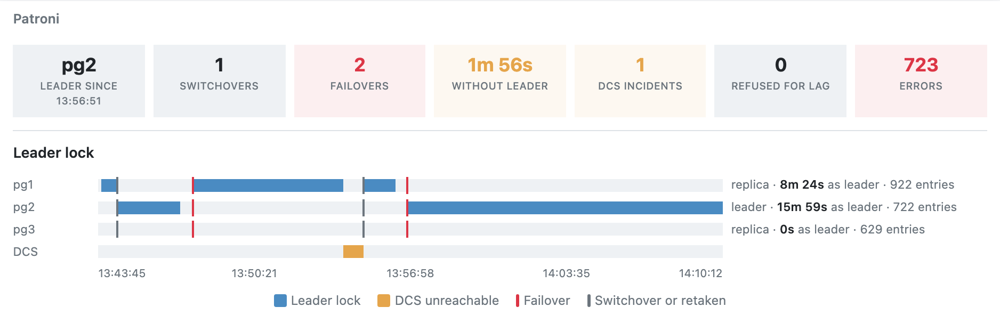
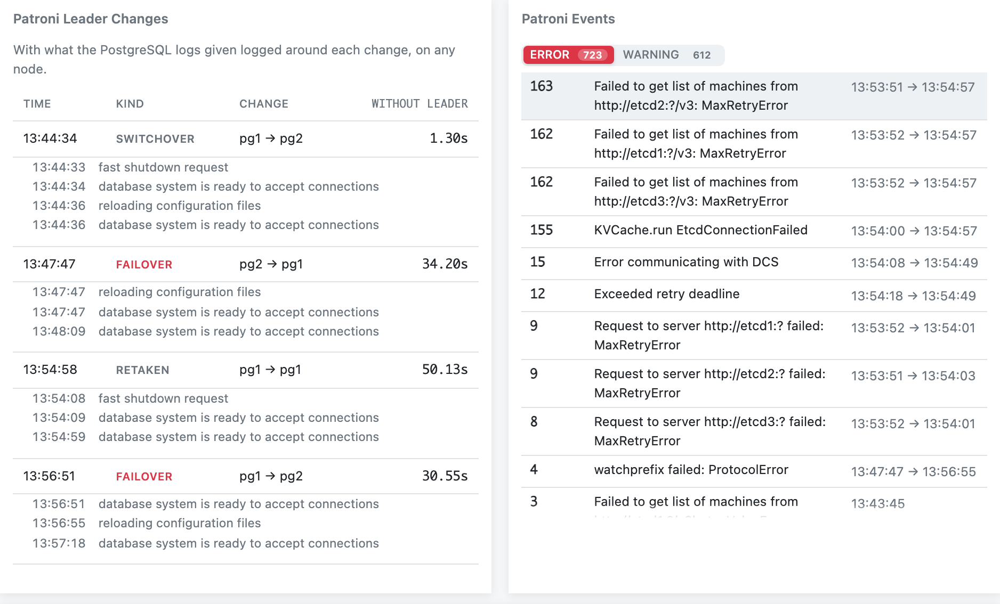

# Patroni

quellog reads [Patroni](https://patroni.readthedocs.io/) logs and reports on the cluster: the leader and since when, each leader change with its cause and the time without leader, DCS incidents, and failovers refused for replication lag.

```bash
quellog /var/log/patroni/patroni-*.log                    # one file per member
quellog /var/log/patroni/patroni-*.log --patroni-detail   # the detailed view
quellog --html node1/patroni.log node2/patroni.log node3/patroni.log
```

Give one log per member. Most Patroni messages do not name their member, so each file is read as one member's view; `I am (pg1)` names it. A member mentioned in the logs but whose own log was not given is listed under **No log from**, and what concerns it is seen by the others only.

## With PostgreSQL logs

Given together, the PostgreSQL report is followed by the Patroni section (`patroni` key in JSON and YAML). Each leader change lists the PostgreSQL lifecycle events logged around it (shutdown, start, crash recovery, reload), from just before the old leader was last seen to 30 s after.

```bash
quellog node*/patroni.log node*/postgresql-*.log
```

These events come from all the PostgreSQL logs given, without telling the nodes apart: an event logged by two nodes reads `×2`. Patroni logs without a time zone, so both logs are assumed to be in the same zone, the default on a node.

## Input

- The default text format (`2026-09-24 13:44:33,372 INFO: ...`), plain or gzip/zstd compressed.
- The same lines behind a `journalctl` prefix (`Sep 24 13:44:33 db1 patroni[812]: 2026-09-24 ...`).
- The JSON format (`log: type: json`), with Patroni's default `asctime`, `levelname` and `message` fields.

## Text report

Text and Markdown are synthetic by default. `--patroni-detail` gives the detailed report alone; `--full` includes it in the full report.

```
$ quellog pg1.patroni.log pg2.patroni.log pg3.patroni.log
PATRONI

  Start date                : 2026-09-24 13:43:45
  End date                  : 2026-09-24 14:10:12
  Members                   : pg1, pg2, pg3
  Leader at end             : pg2 since 13:56:51
  Leader changes            : 3, 1 switchover, 2 failovers, 1 retaken
  Time without leader       : 1m56.181s
  DCS incidents             : 1, longest 49.636s
  Errors                    : 723
  Warnings                  : 612

  Top errors:
    Failed to get list of machines from http://etcd2:?/v3: MaxRetryError   163  13:53:51 → 13:54:57
    Failed to get list of machines from http://etcd1:?/v3: MaxRetryError   162  13:53:52 → 13:54:57
    Failed to get list of machines from http://etcd3:?/v3: MaxRetryError   162  13:53:52 → 13:54:57
    KVCache.run EtcdConnectionFailed                                       155  13:54:00 → 13:54:57
    Error communicating with DCS                                            15  13:54:08 → 13:54:49

  Details: --patroni-detail
```

- **Leader at end**: `none` when the last word is that nobody holds the lock.
- **Leader changes**: a **switchover** when it was requested (a switchover request, a graceful demote, or the switchover key cleared), otherwise a **failover**. A member taking its own lock back, typically once the DCS is back, is **retaken** and not counted as a change.
- **Time without leader**: from the old leader's last lock to the new one's first sighting. The total includes retaken locks.
- **DCS incidents**: from a member's *DCS is not accessible* to its next role report. Overlapping losses are one incident. Patroni's detection delay is not included, so an incident reads shorter than the outage. Connection retries that recover are warnings, not incidents.
- **Refused for lag**: replicas that declined to become leader (*My wal position exceeds maximum replication lag*). Patroni does not log the lag.

### Detailed view

Adds the members, every leader change, the DCS incidents, a timeline (bootstrap, replicas created, switchovers, demotions, promotions, pg_rewind, reinit, crash recovery, pause, DCS lost and back) and the errors and warnings with an ID.

```
$ quellog pg1.patroni.log pg2.patroni.log pg3.patroni.log --patroni-detail
PATRONI

  Start date                : 2026-09-24 13:43:45
  End date                  : 2026-09-24 14:10:12
  Duration                  : 26m27.779s
  Total entries             : 2273
  Members                   : pg1, pg2, pg3
  Leader at end             : pg2 since 13:56:51
  Leader changes            : 3, 1 switchover, 2 failovers, 1 retaken
  Time without leader       : 1m56.181s
  DCS incidents             : 1, longest 49.636s
  Refused for lag           : 0
  Errors                    : 723
  Warnings                  : 612

  Members:
    pg1        replica     8m24.397s as leader     922 entries   13:43:45 → 14:10:12
    pg2        leader     15m59.304s as leader     722 entries   13:43:45 → 14:10:12
    pg3        replica            0s as leader     629 entries   13:43:45 → 14:10:12

  Leader changes:
    13:44:34  switchover  pg1 → pg2   1.305s without leader
    13:47:47  failover    pg2 → pg1   34.197s without leader
    13:54:58  retaken     pg1 → pg1   50.133s without leader
    13:56:51  failover    pg1 → pg2   30.546s without leader

  DCS incidents:
    13:54:08 → 13:54:58  49.636s    pg1, pg2, pg3

  Timeline:
    13:43:52  pg1        bootstrap          initialized a new cluster
    13:43:55  pg2        replica_created    replica has been created using basebackup
    13:43:55  pg3        replica_created    replica has been created using basebackup
    13:44:33  pg1        switchover_request received switchover request with leader=pg1 candidate=pg2 scheduled_at=None
    13:44:33  pg1        demote             Demoting self (graceful)
...
  ERROR                     : 723 (21 kinds)
    er-Vywt  Failed to get list of machines from http://etcd2:?/v3: MaxRetryError    163   22.54%  13:53:51 → 13:54:57
    er-4HFh  Failed to get list of machines from http://etcd1:?/v3: MaxRetryError    162   22.41%  13:53:52 → 13:54:57
    er-OQ5I  Failed to get list of machines from http://etcd3:?/v3: MaxRetryError    162   22.41%  13:53:52 → 13:54:57
```

### One error in detail

`--event-detail` (`-E`) takes the ID of a Patroni error or warning, as it does for PostgreSQL events:

```
$ quellog pg1.patroni.log pg2.patroni.log pg3.patroni.log -E er-21vj
EVENT DETAILS

  Event count | ■ = 1 

  13:48:09 - 13:48:10  ■ 1 
  13:48:10 - 13:48:11   -
  13:48:11 - 13:48:12   -
  13:48:12 - 13:48:13   -
  13:48:13 - 13:48:14   -
  13:48:14 - 13:48:15   -
  13:48:15 - 13:48:16   -
  13:48:16 - 13:48:17   -
  13:48:17 - 13:48:18   -
  13:48:18 - 13:48:19   -
  13:48:19 - 13:48:20   -
  13:48:20 - 13:48:21  ■ 1 

  Id                   : er-21vj
  Severity             : ERROR
  Source               : Patroni, pg2
  Count                : 2
  First Seen           : 2026-09-24 13:48:09
  Last Seen            : 2026-09-24 13:48:21
  Frequency            : 9.83 /min

Normalized Pattern:

 Failed to rewind from healthy primary: pg1

Example:

 Failed to rewind from healthy primary: pg1
```

## HTML report

!!! tip "Demo"
    **[Open the demo on a Patroni lab run →](https://alain-l.github.io/quellog/demo.html?demo=patroni)**: three members' Patroni and PostgreSQL logs, analyzed in your browser.

The leader lock of each member over time, the leader changes with what PostgreSQL logged around them, and the warnings and errors.





## Filters

- Only the time filters (`--begin`, `--end`, `--last`, `--window`) apply. In HTML, the time slider does not re-scope the Patroni section.
- Beside a PostgreSQL report, section flags (`--summary`, `--events`, …) leave the Patroni section out; alone, it is the whole report.
- `--split` is rejected while a Patroni log is given.

## JSON

`start_date`, `end_date`, `duration`, `total_logs`, `error_count`, `warning_count`, `leader`, `leader_since`, `leader_changes`, `switchovers`, `failovers`, `lock_retaken`, `leaderless_time`, `dcs_incidents`, `members`, `members_without_log`, `leadership` (lock terms), `changes`, `event_counts`, `events`, `messages` (each with its `id`, `first_date` and `last_date`). Timestamps and durations use the same formats as the rest of the report.

## Limitations

- A Patroni log inside a tar, zip or 7z archive is skipped with a warning: extract it.
- Standard input is read as a PostgreSQL log: give Patroni logs as files.
- A file is read as Patroni's or PostgreSQL's, by most of its lines. The other's lines are skipped, with a warning when the file is read as Patroni's.
- In the browser, give each member's log as its own file: an archive's members are joined into one stream.
