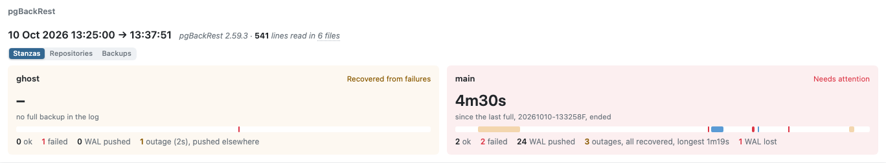
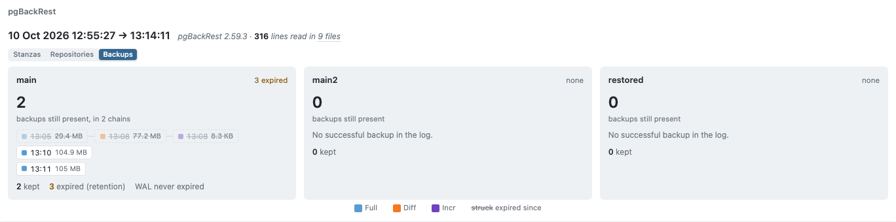
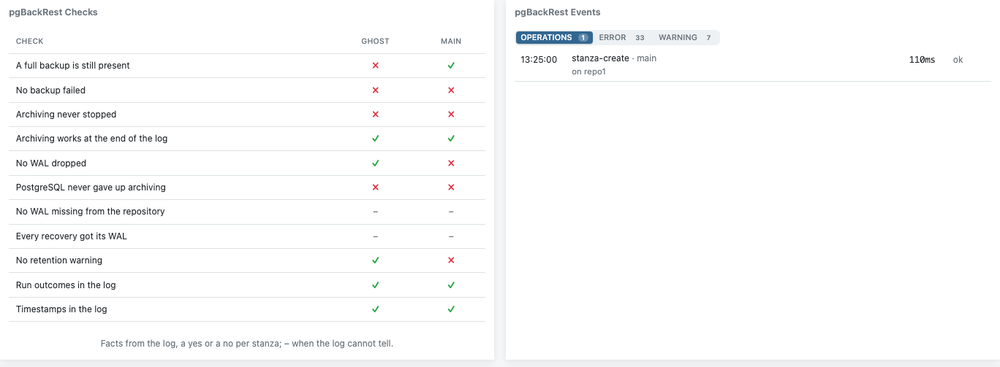
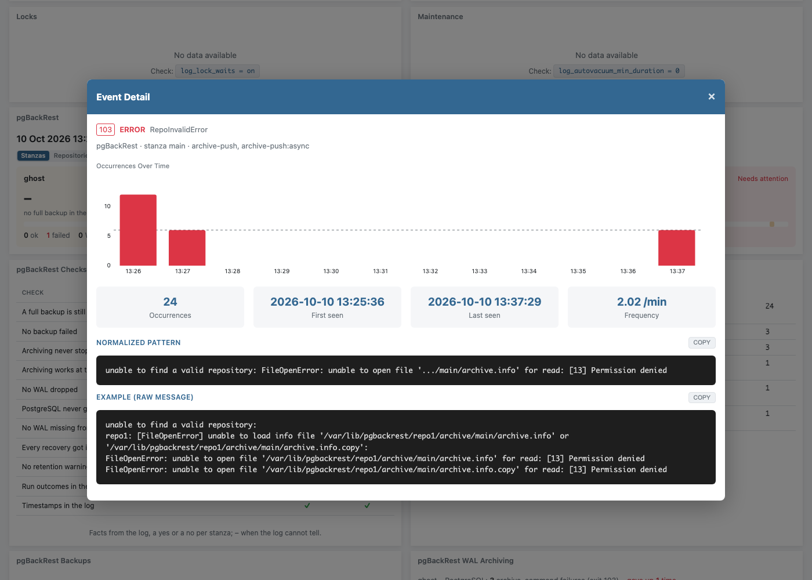
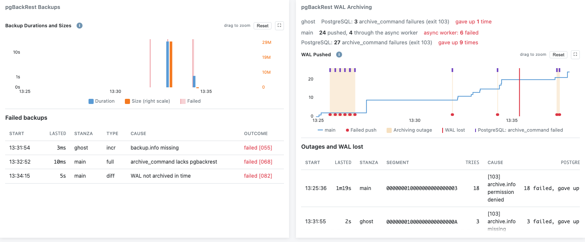
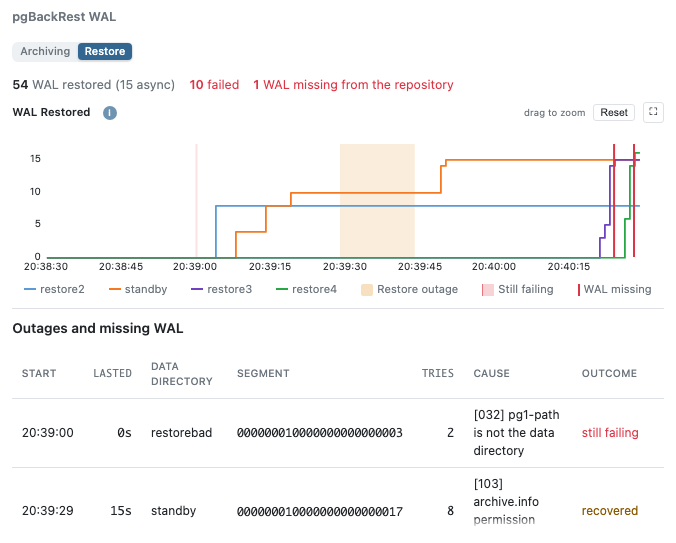

# pgBackRest

quellog reads [pgBackRest](https://pgbackrest.org)'s logs and reports, per stanza, the backups, the WAL archived and restored, and what failed. Give it the PostgreSQL log and pgBackRest's log files together:

```bash
quellog /var/log/postgresql/postgresql-17-main.log /var/log/pgbackrest/*.log
```

Each brings its part, and the report is complete only with both:

| Source | Brings |
|---|---|
| pgBackRest's log files (`/var/log/pgbackrest/<stanza>-<command>.log`) | backups, expire, restores, check, stanza-create…, the async archiving workers |
| The PostgreSQL log | the synchronous `archive-push`/`archive-get` that `archive_command`/`restore_command` run, PostgreSQL's own `archive_command` failures and its "failed too many times" warnings |

The report follows the PostgreSQL one, or stands alone when only pgBackRest's files are given. Compressed files, archives and stdin work as for PostgreSQL logs ([Log Formats](formats.md)).

## Configuration

What the logs hold decides what can be reported. What they do not hold reads "not logged", never 0, and the HTML report names the setting to check.

### pgbackrest.conf

```ini
[global]
log-path=/var/log/pgbackrest
log-level-file=info
log-level-console=warn
log-timestamp=y
```

These are pgBackRest's defaults.

- `log-level-file=info`: every command writes its `command begin` and `command end` to `<log-path>/<stanza>-<command>.log`, which give each backup, expire and restore its outcome and duration. At `warn`, outcomes cannot be told.
- `log-level-console`: what the synchronous `archive-push`/`archive-get` print, which PostgreSQL captures in its own log. At `warn`, only their failures; at `info`, every push, which can then be counted from the PostgreSQL log alone.
- `log-timestamp=y`: without timestamps, runs have no date nor duration.

### postgresql.conf

```ini
archive_mode = on
archive_command = 'pgbackrest --stanza=main --log-level-file=info archive-push %p'
logging_collector = on
```

- `--log-level-file=info` on the command line: the synchronous `archive-push` writes its own log file only then. pgBackRest does not apply `log-level-file` from `pgbackrest.conf` to `archive-push` and `archive-get`. A push then appears in its file and in the PostgreSQL log; quellog counts it once.
- `logging_collector = on`: the output of `archive_command` reaches the PostgreSQL log.

### Restores and standbys

`pgbackrest restore` writes a `restore_command` without `--log-level-file` in the restored `postgresql.auto.conf`:

```ini
restore_command = 'pgbackrest --pg1-path=/var/lib/pg/restore1 --stanza=main archive-get %f "%p"'
```

To have `archive-get` logged, give the restore its own `restore_command`, keeping `--pg1-path` (without it, `archive-get` refuses to run for another data directory, error `[032]`):

```bash
pgbackrest --stanza=main --pg1-path=/var/lib/pg/restore1 restore \
  --recovery-option='restore_command=pgbackrest --stanza=main --pg1-path=/var/lib/pg/restore1 --log-level-file=info archive-get %f "%p"'
```

## Text report

The examples below come from a lab run: a primary archiving to a repository, restores, a standby fed by the archive, the repository made unreadable for a while, then a WAL segment deleted from it.

The default view is a summary per stanza, after the PostgreSQL report:

```
$ quellog pg_logs_*/postgresql.log pgbackrest_logs/*.log
…

PGBACKREST

  Stanza                    : main
  pgBackRest version        : 2.59.3

  main
    Last full               : 20261024-203832F
    Last diff               : 20261024-203832F_20261024-203846D
    Backups                 : 2 ok
    WAL archiving           : 35 pushed, 10 failed, last at 20:40:15
    Archiving outages       : 2, all recovered, longest 6s
    WAL restored            : 54 (15 async), 10 failed, last at 20:40:28
    Missing WAL             : 00000001000000000000001C, pushed at 20:40:06, not found at 20:40:24
    Restores                : 6, last at 20:40:25 (latest), 3 with WAL restore failures

  Top errors:
    [103] archive.info permission denied, push        9  20:39:25 → 20:39:31
    [103] archive.info permission denied, get         8  20:39:29 → 20:39:44
    [032] pg1-path is not the data directory, get     2  20:39:00
    [103] archive.info missing, push                  1  20:38:32

  Details: --pgbackrest-detail[=stanza]
```

- **Archiving outages**: the failure stretches of `archive-push`, per WAL segment, and how they ended: recovered by a later push, still failing at the end of the log, or pushed by another stanza.
- **WAL restored**: the segments `archive-get` handed to PostgreSQL. The "unable to find" that ends every replay, and the probe for the next timeline's `.history` file, are not failures.
- **Missing WAL**: a WAL segment or `.history` file recovery asked for and never got, although its push is in the log: it left the repository. A missing `.history` file makes recovery pick a timeline number already taken.
- **Restores**: each restore is tied to the `archive-get` runs of its data directory (`--pg1-path`). "With WAL restore failures" counts those whose recovery could not get its WAL. Whether PostgreSQL then stopped or promoted is in that instance's own log.
- **Top errors**: grouped by pgBackRest code and cause; `push`/`get` names the command when both have errors.

### Detailed view

`--pgbackrest-detail` gives every stanza, `--pgbackrest-detail=main` one of them (the `=` is needed). It adds the period, PostgreSQL's side, retention, a timeline of every dated event, and the errors and warnings with an ID:

```
$ quellog pg_logs_*/postgresql.log pgbackrest_logs/*.log --pgbackrest-detail
PGBACKREST

  Stanza                    : main
  pgBackRest version        : 2.59.3
  Period                    : 2026-10-24 20:38:32 → 20:40:28, 1m56s
  Read                      : 1248 lines in 10 files

  main
    Last full               : 20261024-203832F
    Last diff               : 20261024-203832F_20261024-203846D
    Backups                 : 2 ok
    WAL archiving           : 35 pushed, 10 failed, last at 20:40:15
    Seen by PostgreSQL      : 10 archive_command failures (exit 103), gave up 3 times for now
    Archiving outages       : 2, all recovered, longest 6s
    WAL restored            : 54 (15 async), 10 failed, last at 20:40:28
    Missing WAL             : 00000001000000000000001C, pushed at 20:40:06, not found at 20:40:24
    Retention               : 2 expire runs, nothing removed
    Restores                : 6, last at 20:40:25 (latest), 3 with WAL restore failures

  Timeline:
    Time      Event               Duration     Size  Result         Detail
    20:38:32  archiving outage          0s           recovered      000000010000000000000001, 1 attempt, [103] archive.info missing
    20:38:32  stanza-create           13ms           ok             on repo1
    20:38:32  backup full               5s  22.1 MB  ok             20261024-203832F
    20:38:46  backup diff               1s   1.6 MB  ok             20261024-203832F_20261024-203846D
    20:38:56  restore                   2s           ok             20261024-203832F_20261024-203846D into /var/lib/pg/restore1, latest
    20:39:00  restore                   2s           ok             20261024-203832F into /var/lib/pg/restorebad, to 20:38:41; recovery: archive-get failed [032]
    20:39:00  WAL restore outage        0s           still failing  000000010000000000000003, 2 attempts, [032] pg1-path is not the data directory, /var/lib/pg/restorebad
    20:39:03  restore                   1s           ok             20261024-203832F into /var/lib/pg/restore2, to 20:38:41
    20:39:08  restore                   2s           ok             20261024-203832F_20261024-203846D into /var/lib/pg/standby, standby
    20:39:25  archiving outage          6s           recovered      000000010000000000000017, 9 attempts, [103] archive.info permission denied
    20:39:29  WAL restore outage       15s           recovered      000000010000000000000017, 8 attempts, [103] archive.info permission denied, /var/lib/pg/standby
    20:40:21  restore                   2s           ok             20261024-203832F_20261024-203846D into /var/lib/pg/restore3, to 20:40:14; recovery: WAL 00000001000000000000001C missing
    20:40:24  missing WAL                            not found      00000001000000000000001C, pushed at 20:40:06, /var/lib/pg/restore3
    20:40:25  restore                   2s           ok             20261024-203832F_20261024-203846D into /var/lib/pg/restore4, latest; recovery: WAL 00000001000000000000001C missing
    20:40:28  missing WAL                            not found      00000001000000000000001C, pushed at 20:40:06, /var/lib/pg/restore4

  ERROR                     : 20 (4 kinds)
    103 - RepoInvalidError
    er-FOWl  archive.info permission denied, push        9   45.00%  20:39:25 → 20:39:31
    er-QjJd  archive.info permission denied, get         8   40.00%  20:39:29 → 20:39:44
    er-ie1w  archive.info missing, push                  1    5.00%  20:38:32
    032 - OptionInvalidValueError
    er-OTk3  pg1-path is not the data directory, get     2   10.00%  20:39:00
  WARN                      : 4 (1 kind)
    wa-7IsV  archive.info permission denied, async get     4  100.00%  20:39:29 → 20:39:44
```

`--full` includes this view in the full report.

### One error in detail

`--event-detail` (`-E`) takes the ID of a pgBackRest error or warning, as it does for PostgreSQL events:

```
$ quellog pg_logs_*/postgresql.log pgbackrest_logs/*.log -E er-QjJd
EVENT DETAILS

  Event count | ■ = 1 

  20:39:29 - 20:39:30  ■■ 2 
  20:39:30 - 20:39:31   -
  20:39:31 - 20:39:33   -
  20:39:33 - 20:39:34  ■ 1 
  20:39:34 - 20:39:35  ■ 1 
  20:39:35 - 20:39:36   -
  20:39:36 - 20:39:38   -
  20:39:38 - 20:39:39  ■■ 2 
  20:39:39 - 20:39:40   -
  20:39:40 - 20:39:41   -
  20:39:41 - 20:39:43   -
  20:39:43 - 20:39:44  ■■ 2 

  Id                   : er-QjJd
  Severity             : ERROR
  Source               : pgBackRest, stanza main
  Error code           : 103 - RepoInvalidError
  Commands             : archive-get
  Count                : 8
  First Seen           : 2026-10-24 20:39:29
  Last Seen            : 2026-10-24 20:39:44
  Frequency            : 31.85 /min

Normalized Pattern:

 unable to find a valid repository FileOpenError: unable to open file '.../main/archive.info' for read: [13] Permission denied

Example:

 unable to find a valid repository
 repo1: [FileOpenError] unable to load info file '/var/lib/pgbackrest/archive/main/archive.info' or '/var/lib/pgbackrest/archive/main/archive.info.copy':
 FileOpenError: unable to open file '/var/lib/pgbackrest/archive/main/archive.info' for read: [13] Permission denied
 FileOpenError: unable to open file '/var/lib/pgbackrest/archive/main/archive.info.copy' for read: [13] Permission denied
```

## HTML report

!!! tip "Try it now"
    **[Open the demo on a pgBackRest lab run →](https://alain-l.github.io/quellog/demo.html?demo=pgbackrest)**: a PostgreSQL log and pgBackRest's own logs, analyzed in your browser.

{ width="820" }

One card per stanza: its state, the age of the last full backup, a gauge of the period (backups, outages, WAL lost or missing) and its counts. The **Repositories** tab gives the same per repository; **Backups** the backups still present, each diff and incr chained to its full, the expired ones struck:

{ width="820" }

{ width="820" }

**Checks** answer yes or no per stanza, "–" when the log cannot tell. **Events** lists the other operations (restores with what stopped their recovery, check, stanza-create, stop, start…), then the errors and warnings; a click on one opens its detail, the HTML counterpart of `--event-detail`:

{ width="820" }

{ width="820" }

**Backups**: the duration (log scale) and size of each backup that succeeded; a failed or killed one is a band over the time it ran, listed under the chart. **WAL**: the segments pushed, cumulated per stanza; bands are outages, red lines WAL lost, red dots failed pushes, violet ticks PostgreSQL's `archive_command` failures. Above the chart, the async worker's share and PostgreSQL's own counts; under it, each outage with PostgreSQL's side.

{ width="820" }

When `archive-get` is logged, a **Restore** tab shows the segments restored, cumulated per data directory (a restored instance, a standby), its outages, and the WAL missing from the repository.

## Filters

- `--begin`/`--end` (and `--last`, `--window`) restrict the pgBackRest report to the window, and it says so.
- `--dbname`, `--dbuser`, `--exclude-user`, `--appname` and the section options (`--summary`, `--sql-summary`…) leave it out: pgBackRest has no database, user or application.
- `--split` periods are PostgreSQL's alone.

## JSON

`--json` and `--yaml` add a top-level `pgbackrest` list, one entry per stanza. Its keys are described in the [web data contract](web-data-contract.md).
