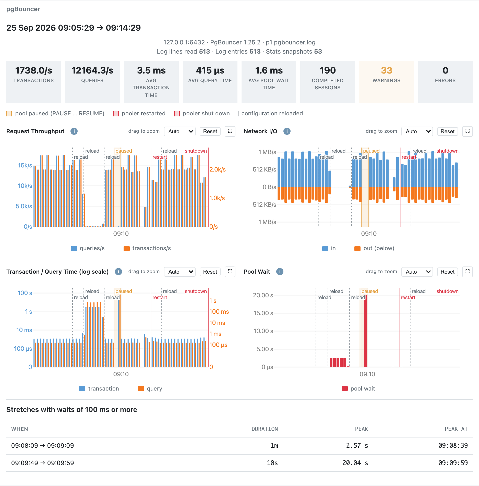
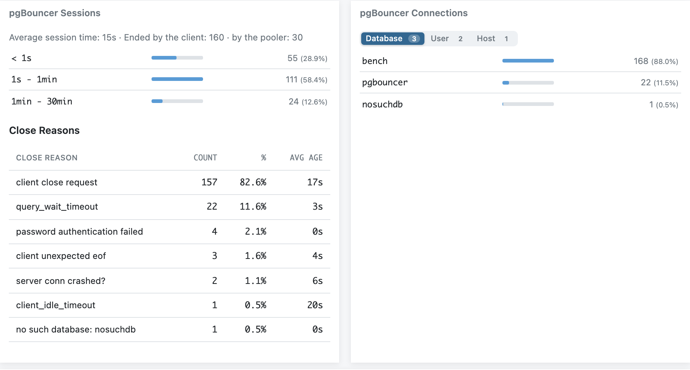

# pgBouncer

quellog reads [pgBouncer](https://www.pgbouncer.org/) logs and reports on each pooler: traffic, timing, pool wait, clients, errors and the pooler's own events. The format is detected from the content ([Log Formats](formats.md#pgbouncer)).

```bash
quellog /var/log/pgbouncer/pgbouncer.log
quellog /var/log/pgbouncer/pgbouncer.log --html -o report.html
quellog /var/log/pgbouncer/pgbouncer.log --json
```

Plain, compressed (`.gz`, `.zst`) and archived (`.tar`, `.tgz`, `.tzst`, `.zip`, `.7z`) logs give the same report.

## Configuration

```ini
# pgbouncer.ini, [pgbouncer] section

# Log destination
logfile = /var/log/pgbouncer/pgbouncer.log
syslog = 0                              # syslog captures are not read (see below)

# Client connection logging
log_connections = 1
log_disconnections = 1
log_pooler_errors = 1

# Telemetry cadence
stats_period = 15                       # seconds; default 60

# The mode the report cannot see
pool_mode = transaction
```

`logfile` and `syslog` need a restart. The other settings take effect on `RELOAD;` from the admin console (`psql -p 6432 pgbouncer`).

!!! warning "Three settings behind the report"
    pgBouncer does not log what it leaves out. Without `log_connections` or `log_disconnections`, the client and session sections are empty. With a `stats_period` longer than the capture, so are the traffic, timing and pool-wait figures. The report says so, but cannot recover the lines.

!!! tip "Volume"
    `log_connections` and `log_disconnections` cost two lines per client connection: cheap under transaction pooling, expensive when clients reconnect per query. `stats_period` costs one line per period.

!!! danger "verbose"
    `verbose = 1` or `2` adds DEBUG and NOISE lines: 1 686 lines for six transactions in a real capture. quellog counts them and sets them aside. Leave `verbose` unset outside a debugging window.

### Settings and report sections

| Setting | Feeds |
|---------|-------|
| `log_connections` | Login attempts, connections per database, user and host, server connections opened |
| `log_disconnections` | Completed sessions, session time, close reasons |
| `log_pooler_errors` | Warnings and errors: `query_wait_timeout`, `client_idle_timeout`, authentication failures, reserve pool |
| `stats_period` | Traffic, network, timing and pool wait: one `stats:` line per period |
| `logfile` | Everything: syslog captures are not read |
| `pool_mode` | Nothing: it is not in the log, but it sets what pool wait means |

### `stats_period`

Traffic, timing and pool wait come from `stats:` lines only. At the default 60 s:

- a capture under a minute has no figure;
- a few minutes give two or three points, and a burst is flattened over a minute;
- the first snapshot after a restart averages an idle period.

`stats_period = 15` gives four points a minute.

### `pool_mode`

pgBouncer does not log `pool_mode`, and the report is the same under every mode. The mode changes what two figures mean:

- **Pool wait** is a mean per server assignment: once per session, per transaction or per statement.
- **Server connections opened**: session pooling opens more backends than transaction pooling for the same clients.

## With PostgreSQL logs

PostgreSQL and pgBouncer logs given together produce the PostgreSQL report, then one pgBouncer section per pooler (a top-level `pgbouncer` list in JSON).

```bash
quellog /var/log/postgresql/*.log /var/log/pgbouncer/pgbouncer.log
quellog /var/log/postgresql/*.log /var/log/pgbouncer/pgbouncer.log --html -o report.html
```

A file written by both daemons goes to the track of most of its lines, PostgreSQL on a tie. The other daemon's lines are left out, and counted under `Set aside` when the file is read as a pooler log.

## Several poolers

Each pooler gets its own report. quellog groups the files into poolers:

- one after the other, same PID: a rotated log;
- one after the other, same listen address: a restart into a new file;
- overlapping in time: two poolers, even on the same address.

A pooler log inside an archive counts as a file, named `archive/member`. A pooler is named after its listen address, or after its first file when the log has none.

## Input

Single-line records with a `timestamp [PID] SEVERITY` prefix:

| Line | Feeds |
|------|----------------|
| `LOG stats: <n> xacts/s, <n> queries/s, …, in <n> B/s, out <n> B/s, xact <n> us, query <n> us, wait <n> us` | Throughput, network I/O, transaction, query and wait times: averages over one `stats_period` |
| `LOG C-0x…: db/user@host login attempt: …` | Client connections (login attempts) and the per-database/user/host breakdown |
| `LOG S-0x…: … new connection to server …` | Server connections |
| `LOG …: … closing because: <reason> (age=Ns)` | Completed sessions, the session-time histogram, and per-database/user/host breakdown |
| `WARNING`/`ERROR`/`FATAL …` | The error list (including `pooler error: …` and `taking connection from reserve_pool`) |
| `LOG process up: PgBouncer X.Y.Z`, `LOG listening on …`, `LOG got SIG…`, `LOG … command issued` | The pooler's name, release and timeline: starts, shutdowns, reloads and admin console commands (`PAUSE`, `RESUME`, `SUSPEND`, `KILL`, …) |

## Text report

Text and Markdown are synthetic by default, and the text report holds in 80 columns. `--pgbouncer-detail` gives the detailed report alone; `--full` includes it in the full report.

```
$ quellog pgbouncer.log
PGBOUNCER

  Pooler                    : 127.0.0.1:6432, PgBouncer 1.25.2
  Start date                : 2026-09-25 09:05:29 UTC
  End date                  : 2026-09-25 09:14:29 UTC
  Throughput                : 1738.0 transactions/s, 12164.3 queries/s
  Avg time                  : transaction 3.5 ms, query 415 µs
  Avg pool wait time        : 1.6 ms
  Clients                   : 191 login attempts, 190 sessions of 15s on average
  Server connections        : 15 opened, 1 reserve pool activation

  Messages: 0 errors, 33 warnings
    query_wait_timeout                          22  09:08:09 → 09:08:20
    password authentication failed               4  09:10:29
    server conn crashed?                         2  09:10:59
    client_idle_timeout                          1  09:12:24
    got packet 'E' from server when not linked   1  09:10:59
    … and 3 more

  Activity by minute | ■ = 1k queries/s

                              queries  query      wait      events
  09:05  ■■■■■■■■■■■■■■■      15.4k/s  159 µs               start
  09:06  ■■■■■■■■■■■■■■■      15.1k/s  159 µs
  09:07  ■■■■■■■■■■■■■■■■     15.7k/s  160 µs               reload
  09:08  ■                     1.4k/s  775.2 ms   2.57 s    reload
  09:09  ■■■■■■■■              7.6k/s  3.16 s     20.04 s   pause 20s, reload
  09:10  ■■■■■■■■■■■■■■■      15.1k/s  166 µs
  09:11  ■■■■■■■■              8.4k/s  488 µs     2.2 ms    restart
  09:12  ■■■■■■■■■■■■■■■■     15.8k/s  158 µs               reload
  09:13  ■■■■■■■■■■■■■■■      15.2k/s  158 µs
  09:14  ■■■■■■■■■■■■■        13.5k/s  217 µs               shutdown
  query: query time, wait: pool wait, worst snapshot of each row

  Details: --pgbouncer-detail
```

- **Messages**: errors before warnings, the most frequent first, five of them, then `… and N more`.
- **Activity**: one row per snapshot, or per time bucket beyond 12 rows. A row starts at the beginning of the period it covers and shows the worst query time and pool wait of its snapshots. Rows without traffic fold into one.
- With fewer than two snapshots, a timeline replaces the activity table.

### Detailed view

Adds the files, the lines read and set aside, network, wait stretches, who ended the sessions, the max snapshot averages, message IDs, up to 20 activity rows, the session-time histogram, the close reasons and the connections per database, user and host (ten rows at most, cut at 80% from the fifth).

```
$ quellog pgbouncer.log --pgbouncer-detail
PGBOUNCER

  Pooler                    : 127.0.0.1:6432, PgBouncer 1.25.2
  Files                     : p1.pgbouncer.log
  Start date                : 2026-09-25 09:05:29 UTC
  End date                  : 2026-09-25 09:14:29 UTC
  Duration                  : 9m0.144s
  Log lines                 : 513 read
  Stats snapshots           : 53
  Throughput                : 1738.0 transactions/s, 12164.3 queries/s
  Network                   : 724.70 KB/s in, 316.26 KB/s out
  Avg time                  : transaction 3.5 ms, query 415 µs
  Avg pool wait time        : 1.6 ms
  Wait stretches            : 2, longest 1m from 09:08:09
  Clients                   : 191 login attempts, 190 sessions of 15s on average
  Sessions ended by         : the client 160, the pooler 30
  Server connections        : 15 opened, 1 reserve pool activation

  Max snapshot averages
    Throughput              : 2520 transactions/s, 17642 queries/s at 09:12:43
    Network                 : 1.03 MB/s in, 458.62 KB/s out at 09:12:43
    Time                    : transaction 60.12 s, query 3.16 s at 09:09:49
    Pool wait               : 20.04 s at 09:09:49

  Messages: 0 errors, 33 warnings
    wa-2Xo6  query_wait_timeout                          22  09:08:09 → 09:08:20
    wa-zZfu  password authentication failed               4  09:10:29
    wa-S1AV  server conn crashed?                         2  09:10:59
    wa-7RKL  client_idle_timeout                          1  09:12:24
    wa-ELGU  got packet 'E' from server when not linked   1  09:10:59
    wa-lWMX  no such database: nosuchdb                   1  09:10:29
    wa-r4MI  server login failed: FATAL the database s…   1  09:10:59
    wa-JC9n  taking connection from reserve_pool          1  09:08:07

  Activity per 30s | ■ = 1k queries/s

...
  Sessions per close reason:
    client close request               157   82.6%  avg 17s
    query_wait_timeout                  22   11.6%  avg 3s
    password authentication failed       4    2.1%  avg 0s
...
  Connections per database:
    bench         168   88.0%
    pgbouncer      22   11.5%
    nosuchdb        1    0.5%
```

### One error in detail

`--event-detail` (`-E`) takes the ID of a pooler warning or error, as it does for PostgreSQL events:

```
$ quellog pgbouncer.log -E wa-2Xo6
EVENT DETAILS

  Event count | ■ = 1 

  09:08:09.031 - 09:08:09.948  ■■■■■■■■■■■■■■■■■■■■■ 21 
  09:08:09.948 - 09:08:10.865   -
  09:08:10.865 - 09:08:11.782   -
  09:08:11.782 - 09:08:12.699   -
  09:08:12.699 - 09:08:13.616   -
  09:08:13.616 - 09:08:14.533   -
  09:08:14.533 - 09:08:15.450   -
  09:08:15.450 - 09:08:16.367   -
  09:08:16.367 - 09:08:17.284   -
  09:08:17.284 - 09:08:18.201   -
  09:08:18.201 - 09:08:19.118   -
  09:08:19.118 - 09:08:20.035  ■ 1 

  Id                   : wa-2Xo6
  Severity             : WARNING
  Source               : pgBouncer, 127.0.0.1:6432
  Count                : 22
  First Seen           : 2026-09-25 09:08:09 UTC
  Last Seen            : 2026-09-25 09:08:20 UTC
  Frequency            : 119.96 /min

Normalized Pattern:

 query_wait_timeout

Example:

 C-0x559cb8f46718: bench/bench@127.0.0.1:55542 pooler error: query_wait_timeout
```

### Notes on the figures

- **Max snapshot averages** are averages over one `stats_period`, not instant peaks. They are dated at the start of their period, like the activity rows; JSON keeps the time the line was logged.
- **Timing averages** are weighted by each snapshot's operation count, to the microsecond.
- **Pool wait** measures pool sizing, not queries: read it against `default_pool_size`, `reserve_pool_size` and `max_db_connections`. Its mean is weighted by transactions, the closest count in the log: close under transaction pooling, rougher otherwise.
- **Before pgBouncer 1.23**, `wait` is a queue depth: the report shows clients queued, and HTML has no pool-wait chart.
- **Server connections** counts connections opened, not held.
- **Sessions ended by the client** have a close reason starting with "client "; the pooler refused or closed the others.
- **Reserve pool activations** are listed among the warnings and counted on the server connections row.
- **Session ages** are whole seconds, as pgBouncer logs them.
- **`(nodb)`** is pgBouncer's name for a client not yet bound to a pool. It appears in the session breakdowns only.

### Zero counts

An idle pooler and a silenced one log the same zero.

- A login or session count at 0 reads "although traffic shows" when `stats:` lines show transactions or queries. Server connections opened read the same way.
- With no `stats:` line in the window, a Traffic row says so.
- When the snapshots cover less than half of the window, a Stats coverage row says how much.
- `Messages: 0 errors, 0 warnings` is also what `log_pooler_errors = 0` gives.

## HTML report

Four bar charts: throughput, network I/O, timing and pool wait (three before pgBouncer 1.23). One bar per snapshot up to 60, grouped by time bucket beyond; a grouped bar shows the worst snapshot for times and waits. Pauses, restarts, reloads and console commands are marked on the charts. The section has no server connection or reserve pool count.





## Filters

- Time filters (`--begin`, `--end`, `--last`, `--window`) apply.
- `--dbname`, `--dbuser` and `--appname` select PostgreSQL backends and do not apply to the pooler.
- Beside a PostgreSQL report, section flags (`--summary`, `--events`, …) leave the pooler section out of text, Markdown, JSON and YAML. HTML keeps it, and so does a run with pooler logs only.
- SQL flags (`--sql-summary`, `--sql-detail`, …) are ignored.
- `--split` is rejected while a pooler log is given, even as an archive member.

## JSON

`--json` and `--yaml` add a top-level `pgbouncer` list, one entry per pooler:

- `name`, `files`, `listen`, `version` — who the pooler is (see [Several poolers](#several-poolers))
- `events` — its timeline, each `{timestamp, kind, detail}`; `kind` is `start`, `shutdown`, `reload`, or the lowercased console command (`pause`, `resume`, …)
- `start_date`, `end_date` — the first and last record kept, after any time filter, named and written as in the PostgreSQL summary; every time in an entry uses the same `"YYYY-MM-DD HH:MM:SS"` form, on the log's clock
- `lines_read`, `lines`, `lines_unrecognized`, `debug_lines` — lines scanned, entries understood, lines no parser could decode, and how many entries are DEBUG/NOISE
- `stats_sample_count`, `avg_xacts_per_sec`, `max_xacts_per_sec`, `avg_queries_per_sec`, `max_queries_per_sec` — every `max_*` rate is the highest snapshot average, not an instantaneous peak
- `avg_in_bytes_per_sec`, `max_in_bytes_per_sec`, `avg_out_bytes_per_sec`, `max_out_bytes_per_sec`
- `avg_xact_us`, `max_xact_us`, `avg_query_us`, `max_query_us`, `avg_wait_us`, `max_wait_us` — before pgBouncer 1.23, `avg_wait_us` and `max_wait_us` are microseconds of queueing per second (see [Notes on the figures](#notes-on-the-figures))
- `wait_episodes` — `{start, end, peak_wait_us, peak_timestamp}` per stretch during which clients queued
- `max_xacts_per_sec_timestamp`, `max_queries_per_sec_timestamp`, `max_in_bytes_per_sec_timestamp`, `max_out_bytes_per_sec_timestamp`, `max_xact_us_timestamp`, `max_query_us_timestamp`, `max_wait_us_timestamp` — when each maximum was logged, omitted when there is none
- `login_attempts`, `server_connections` (connections **opened** to the servers, not held), `sessions`, `total_session_seconds`, `session_distribution`
- `session_reasons` — `{reason, count, total_seconds}` per close reason
- `connections_per_database`, `connections_per_user`, `connections_per_host`
- `sessions_per_database`, `sessions_per_user`, `sessions_per_host`
- `reserve_pool_activations`, `total_errors` (warnings and errors alike), and `errors` — `{id, level, message, count, first, last}` per distinct warning or error, `id` being the `--event-detail` handle
- `stats_series` — the full per-snapshot time series, ordered by time (used to draw the HTML charts); each snapshot's `time` is when it was logged and `period_start` when the period it averages began: the snapshot before it in the same run of the pooler, the pooler's start, or one period back

## Limitations

- `pool_mode` is not in the log: see [`pool_mode`](#pool_mode).
- The browser demo refuses pgBouncer logs.
- `syslog = 1` logs are not read. Such a file is rejected, and such an archive member is not read as a pooler log.
- A pooler log cannot be read from standard input: give the file.
- Grouping into poolers rests on the log alone. Two hosts' logs on the same address from different days read as one pooler restarted; a restart on another address reads as two poolers.
